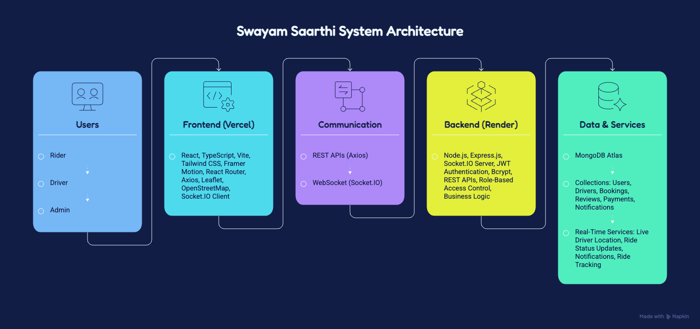
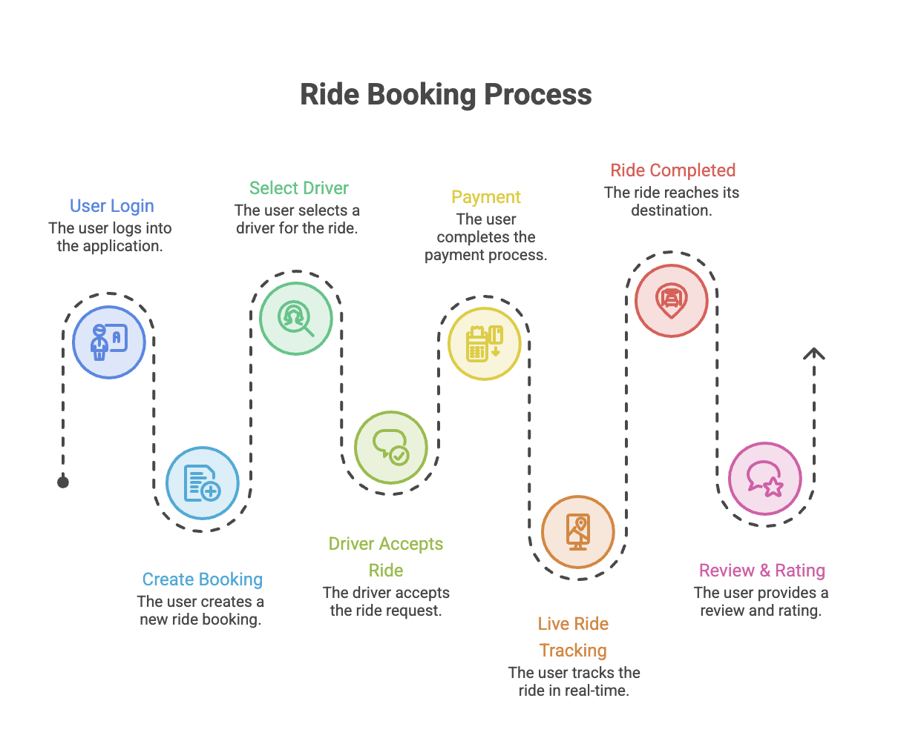
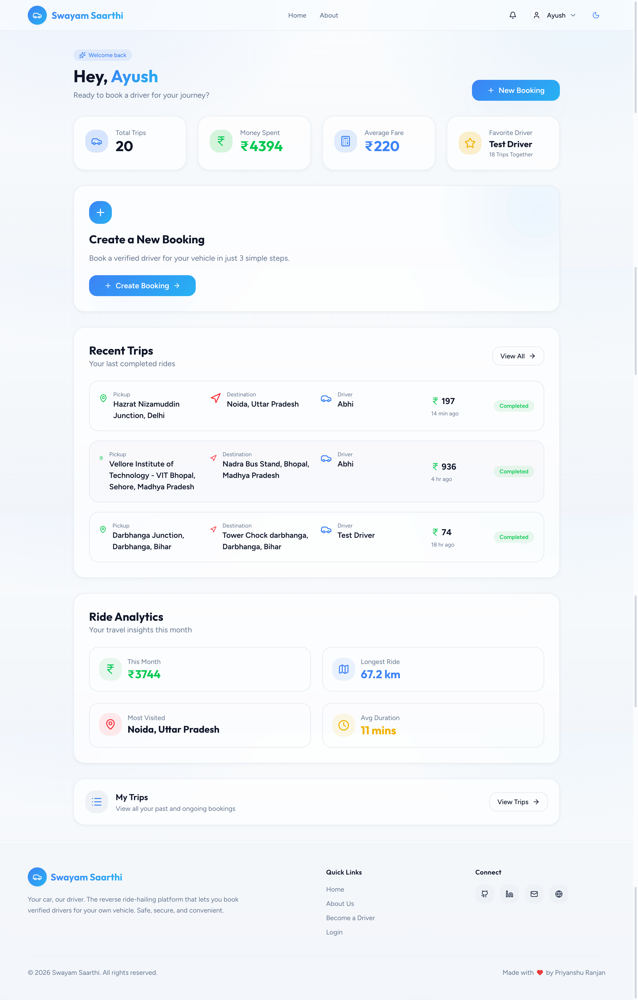
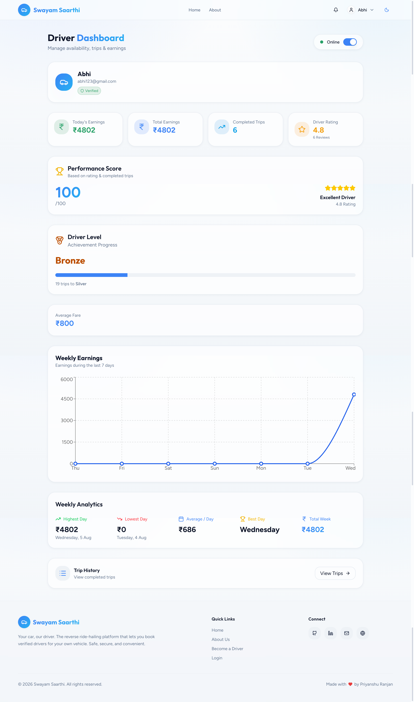
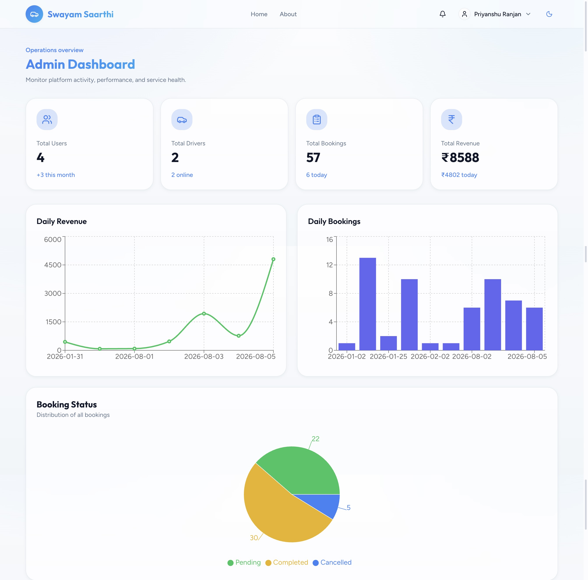
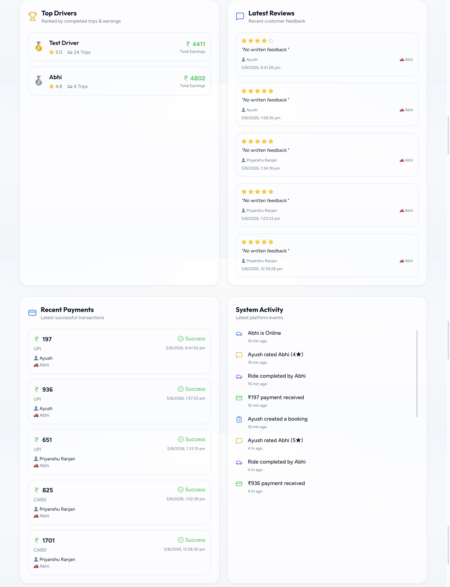

# 🚖 Swayam Saarthi – Smart Ride Booking Platform

> A production-ready full-stack ride booking platform connecting Users, Drivers, and Administrators through a seamless, real-time experience.


---

## 🌐 Live Demo

**Frontend:** https://swayam-saarthi.vercel.app

**Backend API:** https://swayam-saarthi-backend.onrender.com

---

# 📖 Overview

Swayam Saarthi is a modern full-stack ride booking platform that enables users to book rides, drivers to accept and manage bookings, and administrators to monitor the entire platform through analytics dashboards.

The application features real-time booking updates using Socket.IO, secure JWT authentication, role-based access control, live ride tracking using Leaflet & OpenStreetMap, payment workflow, reviews, notifications, and an analytics-rich admin dashboard.

---

# ✨ Features

## 👤 User

- Secure Registration & Login
- JWT Authentication
- Create Ride Booking
- Search Pickup & Destination
- Driver Selection
- Secure Payment
- Live Ride Tracking
- Ride History
- Download PDF Receipt
- Notifications
- Rate & Review Drivers

---

## 🚗 Driver

- Driver Registration & Login
- Online / Offline Availability
- Receive Ride Requests
- Accept / Reject Requests
- Real-Time Ride Updates
- Weekly Earnings Dashboard
- Performance Analytics
- Ride History

---

## 🛠 Admin

- Dashboard Analytics
- Revenue Overview
- Booking Statistics
- User Management
- Driver Management
- Payment Monitoring
- Reviews & Ratings
- Platform Activity Monitoring

---

## 🌟 Project Highlights

- 🚖 End-to-End Ride Booking Workflow
- 🔐 Secure JWT Authentication & Role-Based Access
- ⚡ Real-Time Driver Tracking with Socket.IO
- 🗺 Live Navigation using Leaflet & OpenStreetMap
- 💳 Integrated Payment Workflow
- ⭐ Ratings & Reviews System
- 🔔 Real-Time Notifications
- 📊 Interactive Analytics Dashboards
- 📱 Fully Responsive Modern UI
- ☁️ Deployed on Vercel & Render

---

# 🏗 System Architecture



---

# 📌 Booking Workflow



---

# 🛠 Tech Stack

## Frontend

- React
- TypeScript
- Vite
- Tailwind CSS
- Framer Motion
- Axios
- Socket.IO Client
- Leaflet
- OpenStreetMap
- jsPDF
- React Router

---

## Backend

- Node.js
- Express.js
- MongoDB Atlas
- Mongoose
- JWT Authentication
- Socket.IO
- Bcrypt
- CORS

---

## Deployment

Frontend → Vercel

Backend → Render

Database → MongoDB Atlas

---

# 📷 Application Preview

## 🌐 Landing Page


---

## 👤 User Dashboard



---

## 🚗 Driver Dashboard



---

## 🛠 Admin Dashboard




---

# 📂 Project Structure

```text
Swayam-Saarthi
│
├── Backend
│   ├── src
│   ├── controllers
│   ├── middleware
│   ├── models
│   ├── routes
│   ├── utils
│   ├── app.js
│   └── server.js
│
├── Frontend
│   ├── src
│   ├── components
│   ├── pages
│   ├── contexts
│   ├── hooks
│   ├── services
│   └── assets
│
├── screenshots
└── README.md
```

---

# ⚙ Installation

## Clone Repository

```bash
git clone https://github.com/priyanshuranjan02/Swayam-Saarthi.git
```

---

## Backend

```bash
cd Backend
npm install
npm start
```

---

## Frontend

```bash
cd Frontend
npm install
npm run dev
```

---

# 🔐 Environment Variables

Backend

```env
PORT=
MONGO_URI=
JWT_SECRET=
CLIENT_URL=
```

Frontend

```env
VITE_API_URL=
VITE_SOCKET_URL=
```

---

# 📈 Future Enhancements

- Google Authentication
- Forgot Password
- Email Verification
- Ride Cancellation Charges
- Surge Pricing
- Promo Coupons
- Multi-language Support
- Driver Documents Verification
- Push Notifications
- Ride Scheduling

---

<div align="center">

## 👨‍💻 Developed by

# Priyanshu Ranjan

**Full Stack Developer • AI & Machine Learning Enthusiast**

*"Building intelligent, scalable, and real-time software solutions that solve real-world problems."*

</div>

# ⭐ Support

If you found this project useful, consider giving it a ⭐ on GitHub.
